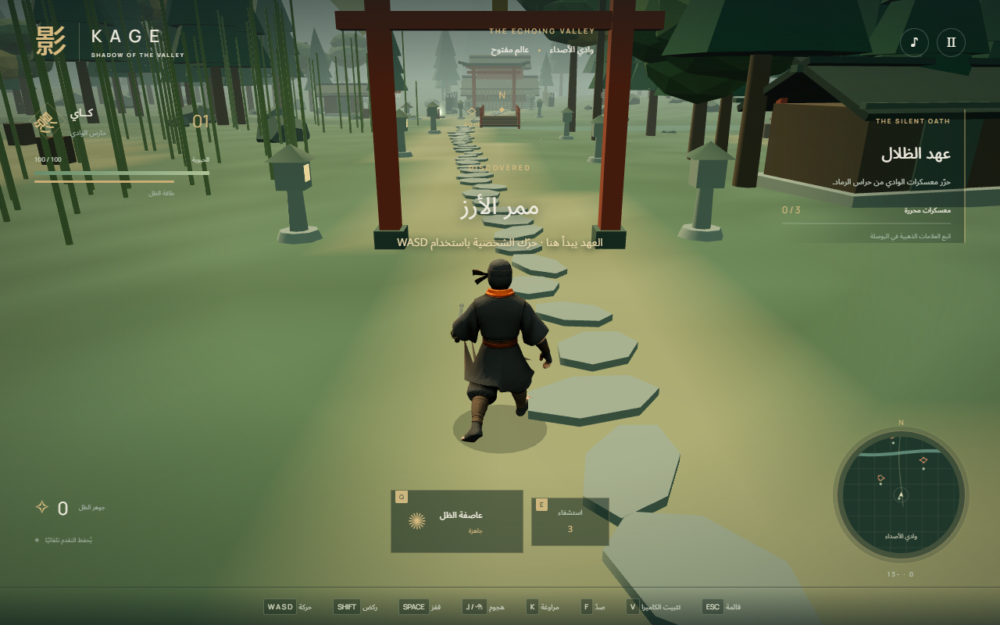
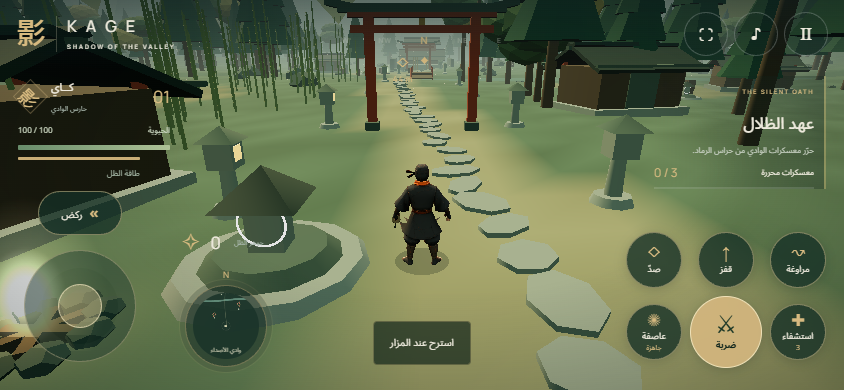

<div align="center">

# 影 KAGE

### Shadow of the Valley · ظل الوادي

**صمتُ الوادي. حدُّ السيف.**

مغامرة قتال ثلاثية الأبعاد في عالم مفتوح، تعمل مباشرة في المتصفح.


[](LICENSE)
[](https://hits.sh/kage-shadow-of-the-valley.ubayda-ai/)

[عن اللعبة](#عن-اللعبة) · [التشغيل](#التشغيل) · [التحكم](#التحكم) · [الترخيص](#الترخيص) · [التواصل](#التواصل)



</div>

## عن اللعبة

في وادي الأصداء، تمتد غابات الأرز والخيزران بين المعسكرات والمزارات ومعبد يختبئ خلف الضباب. تقمّص دور **كاي، حارس الوادي**، واستكشف الطرق بحرية، ثم واجه حراس الرماد لاستعادة السلام.

ابدأ من ممر الأرز، وحرّر المعسكرات الثلاثة لتفتح بوابة المعبد. هناك تنتظرك المواجهة الأخيرة مع حارس المعبد. وبعد إنهاء العهد، يمكنك مواصلة التجول في الوادي.

## ما الذي يميز KAGE؟

- **وادٍ مفتوح للاستكشاف:** غابات، نهر، جسور، مبانٍ، مزارات، ومعسكرات مترابطة.
- **قتال بالسيف:** سلسلة من ثلاث ضربات، صدّ، صدّ مثالي، ومراوغة تمنح حصانة قصيرة.
- **عاصفة الظل:** ضربة دائرية تصيب الأعداء القريبين، مع إدارة للطاقة وإعادة الشحن.
- **خصوم ومواجهة نهائية:** أعداء يتنبهون لاقترابك ويعلنون هجماتهم بتوهج أحمر.
- **راحة واستشفاء:** جرعات لاستعادة الحيوية، ومزارات لتجديد الحيوية والطاقة والجرعات خارج القتال.
- **خريطة وبوصلة:** علامات للمعسكرات والمزارات والأعداء، مع اتجاه الهدف والمسافة إليه.
- **حفظ تلقائي:** يحتفظ المتصفح بتقدم المعسكرات والموقع والجواهر والجرعات.
- **هاتف وكمبيوتر:** واجهة عربية، وتحكم لمس كامل، واللعب بالوضع الأفقي على الهاتف، وإعدادات للصوت وجودة الرسوم وحساسية الكاميرا.

## التشغيل

تحتاج إلى متصفح حديث يدعم **WebGL**، وإلى **Node.js 20 أو أحدث** لتشغيل الخادم المحلي. ملفات اللعبة اللازمة مرفقة بالمشروع؛ لا تحتاج إلى تثبيت حزم npm لبدء اللعب.

### أسرع طريقة على Windows

1. نزّل المستودع من **Code → Download ZIP**، ثم فك الضغط.
2. شغّل `START_GAME.bat`.
3. ستفتح اللعبة في المتصفح على **http://localhost:5173**.

اترك نافذة الخادم مفتوحة أثناء اللعب. لإيقافه، اضغط `Ctrl+C` في النافذة ثم أغلقها.

### من سطر الأوامر

افتح الطرفية داخل مجلد المشروع، ثم نفّذ:

```sh
npm start
```

أو شغّل الخادم مباشرة:

```sh
node scripts/serve.mjs
```

افتح **http://localhost:5173** في المتصفح. على Windows، يفتح `npm start` المتصفح تلقائيًا.

> شغّل اللعبة عبر خادم HTTP. فتح ملف `index.html` مباشرة من القرص يمنع تحميل وحدات اللعبة وأصولها في بعض المتصفحات.

## التحكم

| المفتاح | الوظيفة |
| --- | --- |
| `W A S D` أو الأسهم | الحركة بحسب اتجاه الكاميرا |
| سحب الماوس | تدوير الكاميرا |
| عجلة الماوس | تقريب الكاميرا وإبعادها |
| `V` | تفعيل أو إيقاف تثبيت مؤشر الماوس |
| `Shift` | الركض واستهلاك الطاقة |
| `Space` | القفز |
| `J` أو نقرة الماوس اليسرى | هجوم بالسيف وسلسلة ضربات متتابعة |
| `F` أو الماوس الأيمن مطولًا | الصدّ؛ التوقيت الدقيق يمنح صدًّا مثاليًا |
| `K` أو `Alt` | المراوغة |
| `Q` | عاصفة الظل |
| `E` | استخدام جرعة استشفاء |
| `R` قرب المزار | الراحة وتجديد الموارد خارج القتال |
| `Escape` | إيقاف مؤقت وفتح الإعدادات |

### التحكم على الهاتف

تظهر أدوات اللمس تلقائيًا عند تدوير الهاتف **أفقيًا (Landscape)**. في الوضع الطولي تظهر شاشة تطلب تدوير الجهاز، ولا يبدأ اللعب حتى يصبح أفقيًا. عند تدويره عموديًا أثناء اللعب، تتوقف اللعبة مؤقتًا؛ أعده للوضع الأفقي ثم اضغط متابعة. زر ملء الشاشة يحاول تثبيت الاتجاه أفقيًا عندما يسمح المتصفح بذلك:

| الأداة | الوظيفة |
| --- | --- |
| عصا الحركة على اليسار | المشي في اتجاه الكاميرا |
| زر الركض فوق العصا | التبديل بين الركض والمشي؛ ينتهي الركض عند نفاد الطاقة |
| ضربة | الهجوم بالسيف؛ انقر بالتتابع لتنفيذ سلسلة الضربات |
| صدّ | اضغط مطولًا للصدّ، أو اضغط في توقيت الهجوم لتنفيذ صدّ مثالي |
| قفز / مراوغة | القفز أو تفادي هجوم الخصم |
| عاصفة | عاصفة الظل؛ يظهر وقت إعادة الشحن على الزر |
| استشفاء | استخدام جرعة؛ يظهر عدد الجرعات على الزر |
| زر الراحة عند الاقتراب من المزار | استعادة الحيوية والطاقة والجرعات خارج القتال |
| سحب المشهد بإصبع | تدوير الكاميرا |
| التقريب والإبعاد بإصبعين على المشهد | تغيير مسافة الكاميرا |
| زر الإيقاف أعلى الشاشة | الإعدادات، ودليل التحكم، واستكمال اللعب |
| زر ملء الشاشة | توسيع العرض عندما يدعم المتصفح ذلك |

يمكن تحريك الشخصية وتدوير الكاميرا والضغط على أزرار القتال بأصابع مستقلة في الوقت نفسه. تتوقف المدخلات عند إيقاف اللعبة أو مغادرة الصفحة حتى لا يبقى زر عالقًا. تبدأ الهواتف بجودة رسوم خفيفة تلقائيًا، ويمكن تغييرها من الإعدادات.



## طريقك إلى المعبد

1. **استكشف الوادي:** اتبع العلامات الذهبية في البوصلة والخريطة للوصول إلى المعسكرات.
2. **حرّر المعسكرات الثلاثة:** اهزم جميع حراس كل معسكر لتحريره والحصول على الجواهر والمكافآت.
3. **اعبر البوابة الشمالية:** تُفتح بوابة المعبد بعد تحرير المعسكرات.
4. **واجه حارس المعبد:** راقب توقيت هجماته، ووازن بين الهجوم والصدّ والطاقة.
5. **واصل الاستكشاف:** يظل الوادي متاحًا للتجول بعد الفوز.

**نصيحة للمقاتل:** لا تستهلك طاقتك كلها في سلسلة واحدة. اترك مساحة للمراوغة، واستخدم التوهج الأحمر لتوقع هجوم الخصم، ثم استرح عند أقرب مزار عندما يهدأ القتال.

## الحفظ والإعدادات

يُحفظ التقدم تلقائيًا داخل المتصفح. استخدم المتصفح نفسه وعنوان اللعبة نفسه لاستكمال رحلتك. مسح بيانات الموقع أو اللعب في نافذة خاصة قد يمنع الاحتفاظ بالتقدم.

من قائمة الإيقاف المؤقت، يمكنك اختيار جودة **عالية** أو **خفيفة**، وضبط حساسية الكاميرا والصوت. للأجهزة الأضعف، ابدأ بالجودة الخفيفة. لبدء رحلة جديدة، اضغط خيار إعادة البدء ثم اضغط مرة ثانية لتأكيد مسح التقدم.

## بنية المشروع

```text
game/
├── index.html          واجهة اللعبة
├── style.css           تنسيق الواجهة
├── mobile.css          واجهة الهاتف وشاشة تدوير الجهاز
├── main.js             الحركة والقتال والأعداء والمهمة والحفظ
├── character.js        الشخصية وحركاتها
├── world.js            العالم والمعسكرات والمزارات
├── audio.js            المؤثرات الصوتية
├── mobile-controls.js  عصا الحركة والتحكم بالأصابع
├── assets/             أصول اللعبة
└── vendor/             ملفات التشغيل المرفقة
scripts/
├── serve.mjs           الخادم المحلي
├── check.mjs           فحص الملفات وصياغة JavaScript
└── build.mjs           تجهيز ملفات التشغيل
docs/
├── gameplay.png        لقطة من اللعبة
└── mobile-gameplay.png لقطة أفقية بواجهة الهاتف
tests/                  اختبارات الخادم والتحكم باللمس
START_GAME.bat          مشغّل Windows
```

### فحص المشروع

```sh
npm run check
```

لاختبار الخادم المحلي:

```sh
npm test
```

لاختبارات المتصفح واللمس والاتجاه الأفقي، ثبّت اعتماديات التطوير ومتصفح الاختبار أولًا:

```sh
npm ci
npx playwright install chromium
npm run test:mobile
```

يتحقق الاختبار من حركة عدة أصابع معًا، والقتال والاستشفاء والراحة، ومنع اللعب في الوضع الطولي، وخمسة أحجام أفقية، واستمرار عمل تحكم الكمبيوتر. تُحفظ نتائج الفحص ولقطاته محليًا في `qa-output/`.

لإعادة تجهيز ملفات التشغيل بعد تعديل اعتماديات المشروع:

```sh
npm ci
npm run build
npm run dev
```

يمكن تقديم محتويات مجلد `game/` عبر أي استضافة ملفات ثابتة تدعم JavaScript ES modules وملفات GLB. تقدم اللاعب محلي؛ لا تحتاج اللعبة إلى حساب أو خادم بيانات.

## النشر على سيرفرك واللعب من الهاتف

**هذه لعبة فردية تعمل عبر المتصفح.** يستطيع الزوار فتح رابط السيرفر واللعب في الوقت نفسه، لكن لكل لاعب جلسة وتقدم مستقلان. مشاركة العالم أو القتال بين اللاعبين ليست ضمن هذه النسخة.

### استضافة ملفات ثابتة

1. ارفع **محتويات** مجلد `game/` إلى مجلد الموقع في استضافتك، بحيث يكون `index.html` في جذر عنوان اللعبة.
2. احتفظ بمجلدَي `assets/` و`vendor/` وجميع ملفات JavaScript وCSS كما هي.
3. افتح رابط موقعك على الهاتف أو الكمبيوتر. تدعم الروابط النشر في جذر النطاق أو داخل مجلد فرعي.
4. استخدم HTTPS لموقعك، وتأكد أن الاستضافة تقدم ملفات `.js` بنوع `text/javascript` أو `application/javascript`.

### تشغيل خادم المشروع على Linux

بعد تثبيت Node.js، يمكنك تشغيل النسخة المرفقة دون تثبيت حزم إضافية:

```sh
git clone https://github.com/ubaydaali/kage-shadow-of-the-valley.git
cd kage-shadow-of-the-valley
HOST=0.0.0.0 PORT=8080 npm run dev
```

اربط عنوان اللعبة في استضافتك بهذا الخادم، وأبقِ عملية الخادم عاملة طوال فترة اللعب. يمكنك تغيير `PORT` و`HOST` بما يناسب إعدادات السيرفر.

للتجربة على الهاتف ضمن شبكة المنزل نفسها، شغّل الخادم على الكمبيوتر وافتح **عنوان الكمبيوتر المحلي** مع المنفذ، مثل `http://192.168.1.10:5173`. عنوان `localhost` على الهاتف يشير إلى الهاتف نفسه، وليس إلى الكمبيوتر.

## عدّاد المشاهدات

تظهر شارة مشاهدات المستودع أعلى الصفحة. تعكس الشارة مرات تحميلها من خدمة العدّاد، وليست إحصاءً دقيقًا للزوار الفريدين. [تفاصيل خدمة العدّاد](https://github.com/silentsoft/hits).

## الترخيص

هذه اللعبة متاحة تحت **[رخصة MIT](LICENSE)**، بما يشمل الكود والتوثيق وأصول اللعبة الخاصة بالمشروع.

يمكنك استخدامها في دروسك ومشاريعك، وتعديلها، ونسخها، وإعادة توزيعها، وبيعها أو بناء منتجات تجارية عليها، دون دفع رسوم أو طلب إذن إضافي. لا تُلزمك الرخصة بنشر تعديلاتك أو فتح مصدر منتجك.

عند توزيع نسخ من المشروع أو أجزاء جوهرية منه، يجب الاحتفاظ بنص الرخصة وإشعار حقوق النشر. يُقدَّم المشروع كما هو، دون ضمانات، وفق النص الكامل في ملف `LICENSE`.

Copyright © 2026 Ubayda Ali. تُحفظ تراخيص المكونات المرفقة وإشعاراتها الأصلية؛ راجع [إشعارات الطرف الثالث](THIRD_PARTY_NOTICES.md).

## التواصل

**Ubayda AI**

| القناة | الرابط |
| --- | --- |
| YouTube | [@Ubayda_Ai](https://www.youtube.com/@Ubayda_Ai) |
| البريد الإلكتروني | [admin@onws.net](mailto:admin@onws.net) |
| LinkedIn | [Ubayda Ali](https://www.linkedin.com/in/ubayda-ali-95972a406/) |
| Telegram | [@obedaale](https://t.me/obedaale) |

---

<div align="center">

**KAGE — ظل الوادي** · استكشف. قاتل. أوفِ بالعهد.

</div>
